# The slice's maps (22 Oct 2026)

*Generated by `node tools/slicemaps.js`: change the maps there, not here. Each map is rows of letters, one letter per 32 × 32 tile,
the engine's format (`src/data/places.js`). The `.txt` files are the maps with their marks; `slice.json` is the same as data for the
slice to load; the `.png` files are previews (one square a tile; a dark dot is a mark). Checks run every time: every door, exit and
mark can be reached; R1 is exactly 120 steps with no encounter grass within 10 steps of either end; each mine floor is about 45
steps stair to stair.*

**Checks:** all pass. r1: the road is 120 steps (plan: 120); r1: the road crosses tall grass for 40 of its 99 middle steps (plan: 40); mine1: stairs to stairs 51 steps (plan: about 45); mine2: stairs to stairs 51 steps (plan: about 45); mine3: stairs to stairs 42 steps (plan: about 45).

## Hearthspire (the capital)

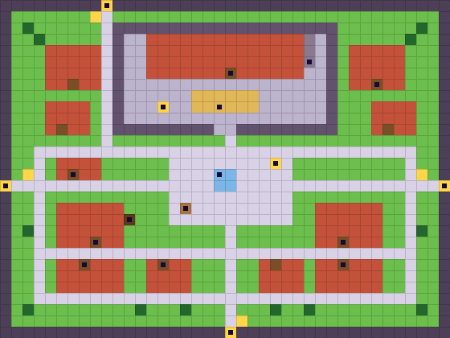

`#` wall (solid) · `G` gate or exit · `.` grass · `o` board or sign (solid) · `M` marble street · `T` tree (solid) · `K` castle wall (solid) · `k` castle yard · `B` building (solid) · `t` tower (solid) · `D` door · `N` the Great Nest (straw) · `|` throne (going up in the yard) (solid) · `F` fountain (solid) · `b` bench (solid) · `h` cellar hatch

No random fights. Set-piece fights: the cellar (rats), the yard drill (recruits), the gate. Players meet at the fountain square.

| x, y | what |
|---|---|
| 8, 21 | bakery (Mallow) |
| 11, 19 | cellar hatch (flour tunnel) |
| 30, 21 | inn (rest, roster, campfire chats) |
| 30, 23 | shop (tier 1) |
| 7, 23 | smithy |
| 14, 23 | moon shrine (talent reset) |
| 33, 7 | barracks |
| 20, 6 | castle hall (the mural) |
| 27, 5 | the tower (the tower fire) |
| 19, 9 | the Great Nest |
| 14, 9 | the throne (act 2) |
| 19, 15 | fountain |
| 16, 18 | Bib's bench |
| 24, 14 | market and note board |
| 0, 16 | the capital gate → R1 |
| 9, 0 | north gate → R5 |
| 39, 16 | east gate → R6 |
| 20, 29 | south gate → R4 |

## R1 (the capital gate → Pebblebrook, 120 steps)

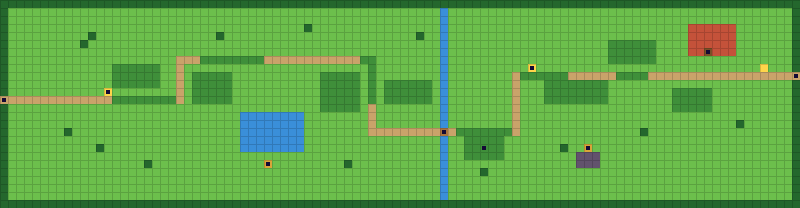

`T` tree (solid) · `.` grass · `~` water (solid) · `B` building (solid) · `"` tall grass (encounters) · `D` door · `,` path · `o` board or sign (solid) · `=` bridge · `c` chest (solid) · `r` rock (solid)

Grubb's toll (boss, L5) stands on the mill road at the Pebblebrook end, after the bridge. Encounters only on tall grass: the road crosses it for 40 of its 100 middle steps, at 7.5% a grass step (3 fights one way); none within 10 steps of either end.

| x, y | what |
|---|---|
| 0, 12 | the capital gate |
| 99, 9 | → Pebblebrook (the mill road) |
| 33, 20 | chest behind the pond |
| 73, 18 | chest on the lookout |
| 88, 6 | raptor stable (shut until the first piece) |
| 55, 16 | the brook bridge |
| 13, 11 | sign: "PEBBLEBROOK 120 steps. Beetles." |
| 66, 8 | Grubb's toll sign |
| 60, 18 | the runaway goat's meadow |

## Pebblebrook

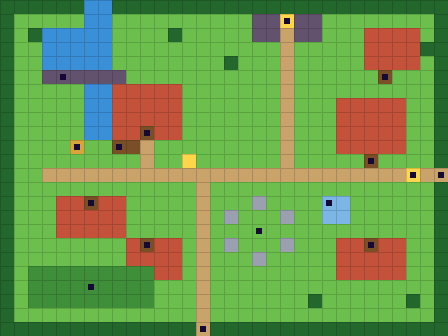

`T` tree (solid) · `~` water (solid) · `.` grass · `r` rock (solid) · `G` gate or exit · `,` path · `B` building (solid) · `D` door · `c` chest (solid) · `W` mill wheel (solid) · `o` board or sign (solid) · `O` circle stones (solid) · `F` fountain (solid) · `"` tall grass (encounters)

Snipe's toll box sits by the mine's mouth until the twist. The circle is the meeting place; the note board is by the fountain.

| x, y | what |
|---|---|
| 31, 12 | ← R1 (the mill road) |
| 14, 23 | → R2 (Sunhaven) |
| 20, 1 | the mine's mouth |
| 10, 9 | the mill (Ruddle; the loft) |
| 8, 10 | the mill wheel |
| 4, 5 | the dam |
| 18, 16 | the circle stones |
| 23, 14 | fountain |
| 26, 11 | inn |
| 26, 17 | shop (tier 2 from level 5) and smith |
| 6, 14 | Tansy's house |
| 10, 17 | the brothers' house |
| 27, 5 | Old Marl's house |
| 6, 20 | the Mossback farms (seed swap) |
| 5, 10 | chest by the dam |
| 29, 12 | welcome sign |

## the mine, floor 1

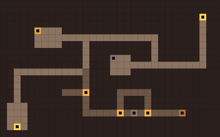

`X` rock wall (solid) · `v` stairs down · `f` mine floor · `c` chest (solid) · `R` cart rails · `x` cart (solid) · `u` stairs up

Copper beetles and scouts; Nugget joins here.

| x, y | what |
|---|---|
| 2, 18 | up: the mine's mouth |
| 26, 16 | Ore's stuck cart (challenge step 1) |
| 5, 4 | chest |
| 16, 8 | Nugget, haggling over a lantern |
| 29, 2 | stairs down |

## the mine, floor 2

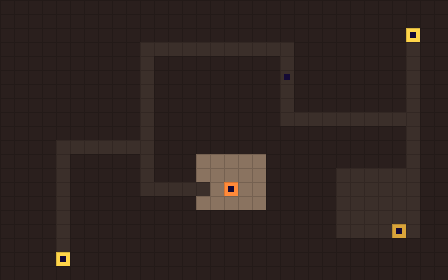

`X` rock wall (solid) · `u` stairs up · `d` unlit floor · `f` mine floor · `C` campfire · `c` chest (solid) · `v` stairs down

Unlit tiles (d): glow grubs light the area around them. The bounty: the Nettlenose scout leader.

| x, y | what |
|---|---|
| 29, 2 | stairs up |
| 16, 13 | campfire (one free heal a visit) |
| 28, 16 | chest in the dark |
| 4, 18 | stairs down |
| 20, 5 | glow grubs light the dark tiles |

## the mine, floor 3

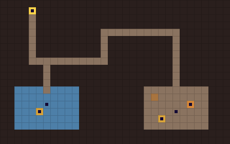

`X` rock wall (solid) · `u` stairs up · `f` mine floor · `w` flooded floor · `x` cart (solid) · `P` copper pile (solid) · `c` chest (solid)

The end of the mine: Snipe, then back up to the circle.

| x, y | what |
|---|---|
| 4, 1 | stairs up |
| 24, 15 | Snipe (boss, L8) on his copper cart |
| 26, 14 | the copper pile |
| 22, 16 | chest behind the cart |
| 6, 14 | the flooded gallery: Old Shellback (hidden trial) |
| 5, 15 | the trial's prize: the flour-dusted apron |

### Room: Mallow's bakery

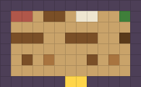

```
wwwwwwwwwwwww
wnnqssqaaqqyw
wqqqqqqqqqqqw
w___qq___qqgw
wqqqqqqqqqqqw
wqzqlqqqzqlqw
wqqqqqqqqqqqw
wwwwwweewwwww
```

`n` the old oven (breaks in the Ordeal) · `g` the cellar door (the flour carts came in here) · `a` flour sacks · `_` the counter; the recipe book on it

### Room: the bakery cellar

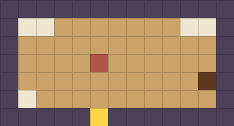

```
wwwwwwwwwwwww
waaqqqqqqqaaw
wqqqqqqqqqqqw
wqqqqnqqqqqqw
wqqqqqqqqqqgw
waqqqqqqqqqqw
wwwwwewwwwwww
```

`g` the flour tunnel (sealed until after the Ordeal) · `n` where Cinder rebuilds the oven frame (act 3) · `e` up to the bakery

### Room: the castle hall

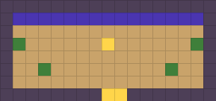

```
wwwwwwwwwwwwwwwww
wmmmmmmmmmmmmmmmw
wqqqqqqqqqqqqqqqw
wyqqqqqq|qqqqqqyw
wqqqqqqqqqqqqqqqw
wqqyqqqqqqqqqyqqw
wqqqqqqqqqqqqqqqw
wwwwwwwweewwwwwww
```

`m` the mural of "the dragon smiler" (a tube on a shoulder) · `|` Snatchclaw's seat

### Room: the Hearthspire inn

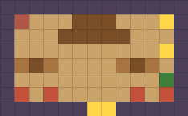

```
wwwwwwwwwwwww
wHqqqsssqqqow
wqqq_____qqqw
wqqqqqqqqqqow
wlzlqqqqlzlqw
wqqqqqqqqqqyw
wpqpqqqqqpqpw
wwwwwweewwwww
```

`H` the hearth: campfire chats · `p` beds (rest) · `o` the roster board

### Room: the mill loft (Pebblebrook)

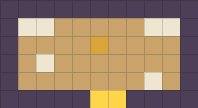

```
wwwwwwwwwww
waaqqqqqaaw
wqqqqcqqqqw
wqaqqqqqqqw
wqqqqqqqaqw
wwwwweewwww
```

`c` the old vote bag (with a hole in it) · `a` flour sacks

